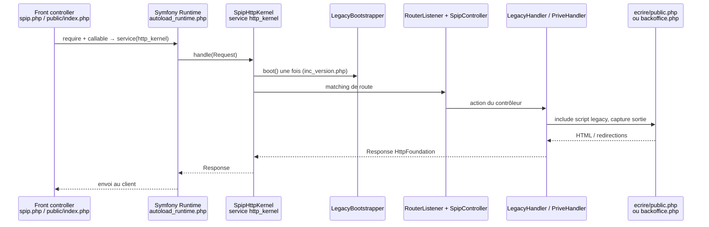

# Cycle applicatif HTTP

Cette page **explique** le parcours d’une requête HTTP dans SPIP 5.0.
Voir aussi [Dépôts spip-league](depots-spip-league.md), [Gestion HTTP](../features/http-request-response.md), [Guard](../features/guard.md).

## En bref

SPIP 5 expose le site via un **front controller** minimal qui délègue au runtime Symfony, puis au noyau HTTP
**spip-league**. Cette page décrit la séquence actuelle d’une requête web : du point d’entrée jusqu’à la
`Response` renvoyée au client.

Pour le rôle de chaque paquet Composer, voir [Dépôts spip-league](depots-spip-league.md). La configuration des
services noyau est dans `vendor/spip-league/kernel/config/services.php`.

L’API moderne partagée (classes `Spip\Framework\*`, fonctions bootstrap `pipeline()`, etc.) est fournie par le paquet
[`spip/framework`](https://git.spip.net/spip/framework) ; les plugins SPIP 5 le déclarent en `require`. Les stubs
`spip-league/sdk` ne dupliquent pas ces symboles.

## Vue d’ensemble



## 1. Point d’entrée et runtime

- **Legacy** : `spip.php` à la racine (forme historique).
- **Standalone** (expérimental) : `public/index.php` — le document root pointe vers `public/`.
- **Mutualisé** (expérimental) : `sites/default/public/index.php`.

Le fichier charge `vendor/autoload_runtime.php` (Symfony Runtime) et retourne une fabrique qui résout le service
`http_kernel` :

```php
return static function (array $context): SpipHttpKernel {
    return service('http_kernel');
};
```

Les helpers `service()`, `app()` et `param()` sont définis dans `vendor/spip-league/kernel/boot.php` : ils
construisent le **Kernel SPIP** et son conteneur au premier appel.

## 2. Boot du Kernel (`spip-league/kernel`)

Lors du premier accès au conteneur :

1. **Environnement** : chargement optionnel des fichiers `.env` (voir [Environnement et Kernel](../upgrade/environnement-kernel.md)).
2. **Installation** : `InstallationDetector` reconnaît la forme (`legacy`, `standalone`, `mutualized`) et les
   répertoires projet (`config/`, cache, web).
3. **Conteneur** : chargement d’un conteneur **compilé** (`tmp/cache/boot/container.prod.php`) s’il est à jour, sinon
   construction à la volée (`SpipContainerFactory`) à partir de :
   - `config/spip/*.php`
   - `vendor/spip-league/kernel/config/services.php`
   - `config/custom.php`
4. **Instance** : création de `SpipLeague\Component\Kernel\Kernel` et enregistrement du service `spip.kernel`.

## 3. Noyau HTTP (`spip-league/http-kernel`)

Le service `http_kernel` (`SpipHttpKernel`) enchaîne pour chaque requête :

1. **`LegacyBootstrapper`** : initialisation unique du core SPIP (`inc_version.php` dans `ecrire/`).
2. **`RequestStack`** : la requête courante est empilée pour toute la durée du traitement.
3. **Routage** : `RouterListener` + routes autour de `Spip\HttpKernel\Controller\SpipController`
   (`ecrire/src/HttpKernel/Controller/`).
4. **Handlers** :
   - **Public** : `LegacyHandler` inclut `ecrire/public.php` (pages et actions `spip.php`).
   - **Back-office** : `LegacyHandler` inclut `ecrire/backoffice.php` (routes `/ecrire/…`).
   - **Espace privé** : `PriveHandler` avec authentification, puis délégation au handler public si besoin.
5. **Réponse** : le contenu legacy est capturé dans un `Symfony\Component\HttpFoundation\Response`. Les
   réponses anticipées passent par `EarlyResponseException`
   ([HTTP Request/Response](../features/http-request-response.md)).
6. **Exceptions** : erreurs non gérées → réponse 500 ou re-lancement selon le mode « catch » du kernel HTTP.

Routes principales du contrôleur SPIP :

| Contexte | Routes (extrait) | Script legacy |
| :--- | :--- | :--- |
| Public | `/{path}`, `/spip.php?action=…` | `ecrire/public.php` |
| Back-office | `/ecrire`, `/ecrire/{path}` | `ecrire/backoffice.php` |
| Privé | `/ecrire/prive.php` | chaîne public + auth |

## 4. État actuel : legacy encapsulé, HTTP moderne en façade

La modernisation est **progressive** : routage et enveloppe Request/Response côté Symfony ; exécution métier
(squelettes, pipelines, formulaires) encore largement dans `ecrire/` via les handlers. La sortie passe souvent par
un tampon (`ob_*`) avant conversion en `Response` — voir [Gestion HTTP](../features/http-request-response.md).

Après activation de plugins, le conteneur peut être **recompilé** ; le Kernel expose `replaceContainer()` pour
appliquer immédiatement les nouveaux services (listeners, tâches cron, etc.) à la requête en cours.

## Voir aussi

- [Dépôts spip-league](depots-spip-league.md)
- [Services et injection de dépendances](../features/services-symfony.md)
- [Environnement et Kernel](../upgrade/environnement-kernel.md)
- [Event Dispatcher et pipelines](../features/event-dispatcher-et-pipelines.md)
- Contrôleur de routes : `ecrire/src/HttpKernel/Controller/SpipController.php`
